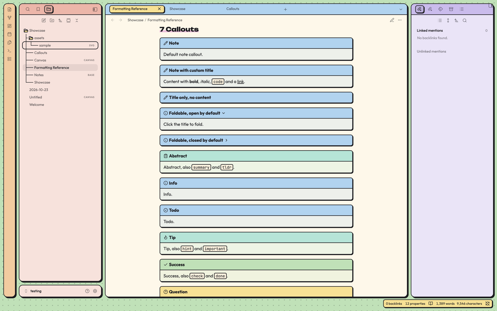

# Neobrutalism Theme

Welcome to the **Neobrutalism Theme**, a colorful and cozy theme for Obsidian. Pastel colors, bold black outlines, hard shadows and rounded corners turn your workspace into a set of friendly boxes on a dotted background, while the writing area stays calm and easy to read.

## Features

- **Boxes everywhere**: Sidebars, tab groups, the ribbon and the status bar are separate boxes with black borders and hard shadows. The layout holds up when you move, split, stack or collapse panes.
- **Pastel color zones**: Green dotted background, a warm eggshell editor, red left sidebar, blue tab bars and a lilac right sidebar. A note keeps its eggshell writing surface wherever you put it.
- **Everything styled**: Callouts, tables, code blocks, tags, checkboxes, properties, embeds, footnotes, settings, command palette, menus, Canvas, Graph view and Bases.
- **Connected file tree**: Tree lines like in LazyVim and simple folder icons that open and close.
- **Fonts included**: Unbounded for headings, Outfit for text and JetBrains Mono for code, embedded in the theme. Nothing is loaded from the internet.
- **Desktop and mobile**: Works on macOS, Windows, Linux, iOS and Android.
- **Customizable**: Gaps, borders, shadows, corner radius, colors, fonts and more with the [Style Settings](https://github.com/mgmeyers/obsidian-style-settings) plugin. Every value is also a CSS variable at the top of `theme.css`.

## Preview

## Style Settings

Install the Style Settings plugin and open its settings tab to adjust:

- **Layout**: gap between boxes, gap on phones, tab bar height, hide the status bar
- **Shape**: border width, shadow offset, corner radius, hover movement, image borders, tree lines
- **Background**: dot grid on or off, dot size and spacing
- **Colors**: background, editor, panels, each sidebar, tab bars, ribbon, status bar, accent, borders, shadows, tags, heading markers, folder icons
- **Typography**: heading font, text font, heading markers on or off

## Notes

- Obsidian's dark mode is not supported yet. When Obsidian runs in dark mode, the theme stays light. A dark version is planned.
- On macOS, Obsidian uses native context menus by default. They are drawn by the system and cannot be themed. Turn off "Native menus" in Obsidian's settings to get the themed menus.
- Folder icon outlines are always 2px, also when you change the border width.

## Fonts

The theme embeds these fonts (Latin subset). All of them are licensed under the [SIL Open Font License 1.1](https://openfontlicense.org).

- [Unbounded](https://github.com/googlefonts/unbounded), Copyright 2022 The Unbounded Project Authors
- [Outfit](https://github.com/Outfitio/Outfit-Fonts), Copyright 2021 The Outfit Project Authors
- [JetBrains Mono](https://github.com/JetBrains/JetBrainsMono), Copyright 2020 The JetBrains Mono Project Authors

## Troubleshooting

If your issue isn't listed here, feel free to open an issue in the repository, and I'll do my best to assist!

## License

[MIT](LICENSE). You are welcome to copy and change the theme, please keep the copyright notice.

---
Enjoy a bold and cozy note-taking experience with the Neobrutalism Theme!
